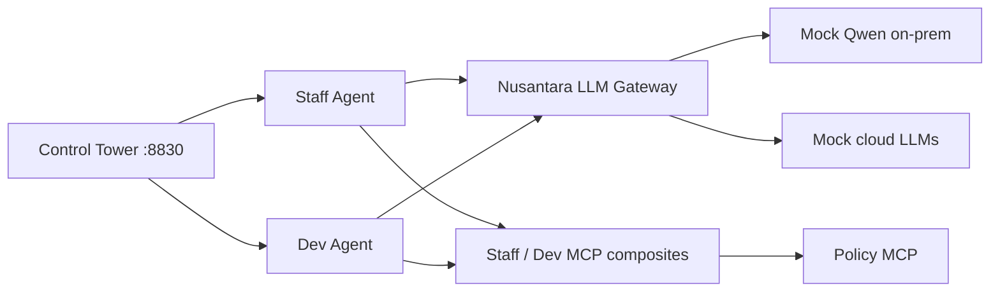

# Nusantara Insurance — AI Gateway demo (Mr. Agus / Charlie)

Custom local Gamma demo for an Indonesian insurer narrative: **OJK / PDP Law**, **NIK & policy PII**, staff vs **Claude Code** developer paths, **Qwen on-prem + Claude/GPT/Gemini**, prompt injection & domain blocking, **Budget-Wise** spend caps.

**New to this repo?** Start with **[TEAM_SETUP.md](TEAM_SETUP.md)** — prerequisites for cloning and running on another laptop, including Gamma ports and the **ACME Hotels LLMs** dependency.

## Prerequisites

- Local Gamma stack on `docker_default` (gateway `:8082`, APIM `:8083`, AM `:8092` / `:8093`).
- AM domain `gamma` with token exchange (Gamma SDK `setup.sh`).
- **ACME Hotels LLMs** API present (clone source for LLM policies).

## Install

```bash
git clone https://github.com/<your-org>/nusantara-insurance-demo.git
cd nusantara-insurance-demo
chmod +x setup.sh
./setup.sh
```

Open http://localhost:8830 and follow [DEMO_SCRIPT.md](DEMO_SCRIPT.md).

### Claude Code CLI through the LLM gateway (policies in the middle)

```bash
./setup-claude-cli.sh
eval "$(python3 provision/claude_env.py)"
claude
```

Full guide: [CLI_CLAUDE.md](CLI_CLAUDE.md).

## Verify

```bash
python3 provision/verify.py
```

## Architecture


